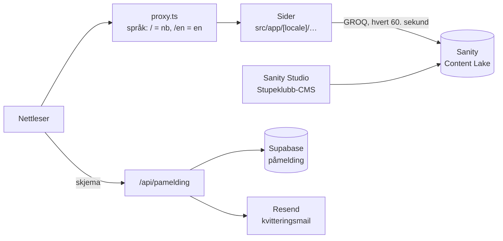

# Bergen Stupeklubb – nettsiden

Nettsiden til Bergen Stupeklubb: informasjon om klubben, påmelding av nye medlemmer og nyheter. Siden finnes på norsk (`/`) og engelsk (`/en`).

- **Rammeverk** – Next.js 16 (App Router), React 19, TypeScript
- **Styling** – Tailwind CSS v4 (`src/app/[locale]/globals.css`)
- **Språk** – next-intl, norsk bokmål og engelsk
- **Påmelding** – Supabase (lagring) og Resend (e-post)
- **Nyheter** – Sanity; Studio ligger i eget repo, [Stupeklubb-CMS](https://github.com/VareggMedia/Stupeklubb-CMS)
- **Drift** – Vercel; hver branch får sin egen preview

## Kom i gang

1. `npm install`
2. Kopier `.env.example` til `.env.local` og fyll inn verdiene (se [Miljøvariabler](#miljøvariabler)). Ikke last opp `.env.local` til GitHub.
3. `npm run dev` – siden kjører på <http://localhost:3000>

| Kommando | Hva den gjør |
| --- | --- |
| `npm run dev` | utviklingsserver |
| `npm run build` | produksjonsbygg – kjør før PR, den fanger typefeil |
| `npm run start` | kjører produksjonsbygget lokalt |
| `npm run lint` | ESLint |
| `npm run typegen` | lager `sanity.types.ts` fra `schema.json` og GROQ-spørringene |

## Arkitektur



Alt kjører i Next.js på Vercel. Sidene bygges på serveren, og bare de interaktive delene (meny, språkvelger, skjema, nyhetskarusell, vannet i toppen) sendes som JavaScript til nettleseren. Nøkler til Supabase og Resend brukes bare på serveren.

## Mappestruktur

```text
src/
  proxy.ts                  språk-proxy (next-intl); hopper over /api, /studio og filer med punktum
  i18n/                     språkoppsett: routing.ts, request.ts, navigation.ts
  app/
    [locale]/               alle sidene – mappenavnet er adressen
      layout.tsx            felles ramme: <html lang>, meny, footer
      page.tsx              forsiden
      bli-med/  for-medlemmer/  om-klubben/  kontakt/  klubbutstyr/  stupskolen/
      nyheter/              nyhetsliste og nyheter/[slug] – én side per sak
      pamelding/            skjema og pamelding/kvittering
      components/           komponenter; Påmelding/, Nyheter/ og HeroWater/ har egne mapper
      data/club.ts          struktur som går igjen: sponsorer, sitater, dører, menylenker
      globals.css           Tailwind og fargene til siden
    api/pamelding/route.ts  tar imot påmeldingen
messages/
  nb.json  en.json          alle tekstene på siden
lib/
  validering/pamelding.ts   Zod-regler for skjemaet – brukes både i nettleseren og på serveren
  Supabase/                 client.ts (nettleser), server.ts og admin.ts (bare server)
  Resend/Resend.ts          sender kvitteringsmailen
sanity/
  env.ts                    prosjekt-ID og dataset fra miljøvariablene
  lib/                      client.ts, queries.ts (GROQ), image.ts (bildeadresser)
sanity.cli.ts               bare for TypeGen
schema.json                 Sanity-skjemaet, kopiert fra Stupeklubb-CMS
sanity.types.ts             generert av `npm run typegen` – ikke rediger
public/images/              bilder: hero-water/, sponsor_img/, divingboard.avif
```

## Slik fungerer delene

### Språk

`proxy.ts` finner språket i adressen: uten prefiks er norsk, `/en/…` er engelsk. Nettleserens språk og cookies brukes ikke – adressen bestemmer alene. Alle sider ligger under `src/app/[locale]/`, og tekstene hentes med `useTranslations()` / `getTranslations()` fra `messages/nb.json` og `messages/en.json`.

Ny tekst legges inn i **begge** filene med samme nøkkel. Lenker inne på siden lages med `Link` fra `src/i18n/navigation.ts`, så de beholder språket.

### Påmelding

1. Skjemaet (`components/Påmelding/`) sjekker feltene med Zod-reglene i `lib/validering/pamelding.ts`.
2. Det sendes til `POST /api/pamelding`.
3. API-et begrenser antall forsøk: en anonym `visitor_id`-cookie og IP-adressen hashes med `RATE_LIMIT_HASH_SECRET` og sjekkes av funksjonen `check_rate_limit` i Supabase.
4. Dataene valideres på nytt på serveren og lagres i tabellen `påmelding`.
5. Resend sender en kvittering til e-posten fra skjemaet. Feiler e-posten, er påmeldingen likevel lagret.
6. Brukeren sendes til `pamelding/kvittering`.

API-et svarer med feilkoder (`invalid`, `rate_limited`, `save_failed`, `server_error`); skjemaet viser teksten på sidens språk. Avsenderen er foreløpig Resends testadresse – den byttes til klubbens domene før lansering.

### Nyheter

Nyhetene skrives i Sanity Studio (<https://stupeklubb.sanity.studio>), som bor i repoet [Stupeklubb-CMS](https://github.com/VareggMedia/Stupeklubb-CMS). Denne siden leser bare: `sanity/lib/client.ts` henter fra det offentlige datasettet uten token, spørringene ligger i `sanity/lib/queries.ts`. Sidene oppdateres hvert 60. sekund, så en publisert sak dukker opp uten ny deploy. Bildene hentes fra `cdn.sanity.io` gjennom `next/image`. `/studio` på denne siden sender videre til Studio.

Endres skjemaet i Stupeklubb-CMS: kjør `npm run schema:extract` der, kopier `schema.json` hit og kjør `npm run typegen`.

### Vannet i toppen

Forsiden har animert vann bak stuperen (`components/HeroWater/`):

- **Plakat først** – bakgrunnen er `poster-wide.avif` / `poster-mobile.avif`, nøyaktig første bilde av animasjonen. Siden ser ferdig ut før noe JavaScript kjører.
- **Animasjonen starter etter at siden har lastet**, når nettleseren har ledig tid. Den tegnes med WebGL i en Web Worker (`water.worker.ts`), ellers på hovedtråden; selve tegningen er i `renderer.ts` og `shaders.ts`.
- **Sparer GPU** – 30 bilder i sekundet, 15 når vinduet ikke har fokus, og pause når fanen er skjult eller vannet er utenfor skjermen.
- **Reserve** – uten WebGL eller med «redusert bevegelse» i systemet blir plakaten stående.
- **Stuperen** er et eget bilde oppå vannet (`diver-crop.avif`, på mobil `diver-crop-mobile.avif`). Plasseringen styres i `HeroWater.module.css` og må stemme med plakaten.

Endres vannet eller shaderne, må plakatene lages på nytt, ellers hopper bildet når animasjonen starter.

## Miljøvariabler

Fyll dem inn i `.env.local` lokalt og i Vercel (Settings → Environment Variables). `NEXT_PUBLIC_` betyr at verdien havner i nettleseren – bruk det aldri for hemmelige nøkler.

| Variabel | Til | Hemmelig |
| --- | --- | --- |
| `NEXT_PUBLIC_SUPABASE_URL` | adressen til Supabase-prosjektet | nei |
| `NEXT_PUBLIC_SUPABASE_PUBLISHABLE_KEY` | offentlig Supabase-nøkkel | nei |
| `SUPABASE_SECRET_KEY` | servernøkkel, brukes til rate limit | **ja** |
| `RESEND_API_KEY` | sender kvitteringsmailen | **ja** |
| `RATE_LIMIT_HASH_SECRET` | hasher IP og besøks-ID før de lagres | **ja** |
| `NEXT_PUBLIC_SANITY_PROJECT_ID` | Sanity-prosjektet, `198akpfr` | nei |
| `NEXT_PUBLIC_SANITY_DATASET` | Sanity-datasettet, `production` | nei |

## Arbeidsflyt

- Ta en sak fra [prosjekttavla](https://github.com/orgs/VareggMedia/projects/1/views/1), lag en branch fra `dev` med navnet `<saksnummer>-kort-beskrivelse`, f.eks. `56-konvertere-css-til-tailwind`.
- PR går til `dev`. Bare `dev` kan merges inn i `main` – GitHub-sjekken «Validate PR flow» stopper alt annet.
- Vercel lager en preview for hver branch; lenken kommer i PR-en.
- Før PR: `npm run lint` og `npm run build` uten feil.
